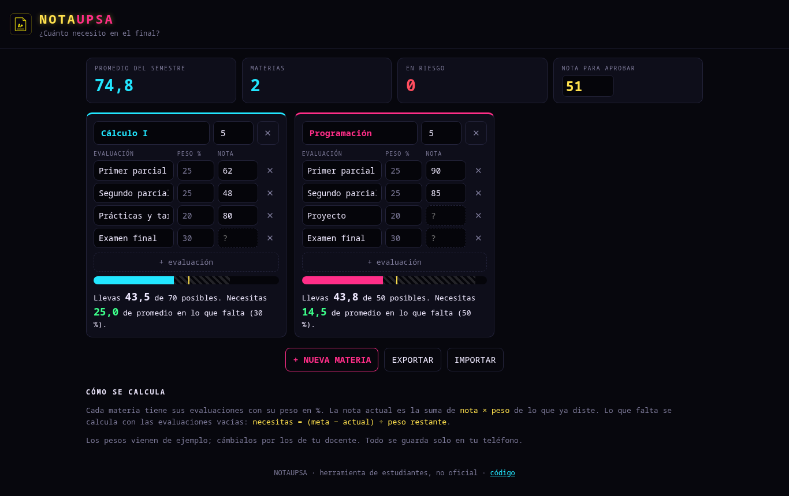

<div align="center">



### ¿Cuánto necesito en el final? Pon tus notas y lo sabes al toque.

<a href="https://neckhurtttt.github.io/NotaUPSA/"></a>




</div>

## 📚 Qué hace

- Cada materia con sus evaluaciones y **pesos** (parciales, prácticas, final… los que tenga tu docente).
- Te dice cuánto llevas, **cuánto necesitas de promedio en lo que falta** y si ya aprobaste o ya no alcanza.
- **Promedio del semestre** ponderado por créditos y cuántas materias están en riesgo.
- Nota mínima configurable (51 por defecto).
- Se **instala en el teléfono** como app y funciona sin internet (service worker).
- Todo se guarda **solo en tu teléfono**; puedes exportar e importar un respaldo `.json`.

## 🧮 La cuenta

```
actual    = Σ nota × peso / 100          (solo lo que ya diste)
necesitas = (meta − actual) / peso que falta × 100
```

> Herramienta hecha por estudiantes, no es un sistema oficial de la universidad.

<div align="center"><sub>NOTAUPSA · hecho por <a href="https://github.com/NeckHurtttt">NeckHurtttt</a></sub></div>
